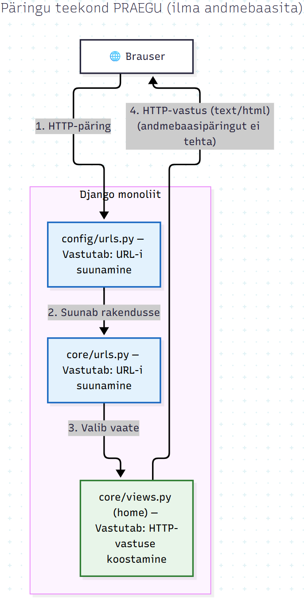
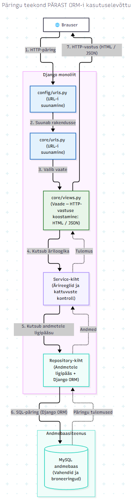

# PAEVIK – LabBook / Juhend 1

Liikmed: A = Mihkel  B = Siim
Eesmärk: Django + MySQL tehniline alus (broneerimisloogikat veel pole).

## Tööjaotus

| kuupäev | tegevus | driver | navigator | kes kontrollis | tulemus |
|---|---|---|---|---|---|
| 24.11.2026 | Ülesanne 1: arhitektuur | A | B | B | |
| 24.11.2026 | Ülesanne 2: projekti alus, .gitignore | A | B | B | |
| 24.11.2026 | 3. MySQL (mõlemal masinal) | A+B | A+B | | |
| 24.11.2026 | 4. .env, settings.py, ühenduse test, migrate | B | A | A | |
| 24.11.2026 | 5. home-vaade ja katsed 1–3 | A | B | B | |
| 24.11.2026 | 6. KONTROLL.md, PAEVIK.md, commit | B | A | A | |
| 24.11.2026 | 6.4 GitHub push (A); klooni ja käivita (B) | A / B | B / A | | |

## Arhitektuur

 

Miks monoliit (3–5 lauset): Valisime monoliidi kuna see on üks suur koodi baas, mitte palju väikeseid üheskoos.
Monoliitti on kergem arendada ja vajab vähem algelist seadistust.
See sobib paremini väiksematele projektidele.

## Katsed (ennustus → muudatus → tulemus → selgitus → taastamine)

### Katse 1 – INSTALLED_APPS
Ennustus (enne katset): Annab errori.

Tulemus: Midagi ei muutunud.

Selgitus: INSTALLED_APPS ütleb Djangole, et core kuulub projekti (mudelid, migratsioonid, admin, mallid). URL-i ja vaate leidmiseks seda ei vaja, sest config/urls.py impordib core.urls otse. Mõju hakkab paistma alles siis, kui core-s on mudelid ja migratsioonid.

Taastatud: [x]
### Katse 2 – URL-i eemaldamine
Ennustus: Ei kuva lehte enam.

GET / staatus ja kuva: Nägime Django tervituse lehte.

Selgitus: Kui projekti URL-ide hulgas on alles ainult admin/, näitab Django aadressil / DEBUG-režiimis oma tervituslehte, mitte viga. Muude aadresside jaoks seda erandit ei ole.

Taastatud: [X]
### Katse 3 – olematu URL
Ennustus: Annab vea 404.

Staatus (404?) ja / uuesti (200?): Tekkis viga 404.

Selgitus: Tervitusleht on erand ainult aadressil /. Mis tahes teine tundmatu aadress annab tavalise 404.
## Probleemid ja lahendused
- Probleemid puuduvad.

## Isiklikud selgitused (MySQL + Django ühendamine)
A: Django ühendub MySQL-iga mysqlclient draiveri, settings.py (DATABASES) seadete ja .env-st (python-dotenv) laetud parooli abil. import MySQLdb kontrollib vaid draiverit – tegelikku ühendust tõestab Django shellis päring SELECT DATABASE(), CURRENT_USER().

B: Django loob MySQL-iga ühenduse mysqlclient-draiveri, settings.py (DATABASES) sätete ja .env-failist (python-dotenv) võetud parooli abil. Kui import MySQLdb testib vaid draiverit, siis reaalse ühenduse toimimist näitab Django shellis tehtav päring SELECT DATABASE(), CURRENT_USER().
## Vastused küsimustele (oma sõnadega)
- Miks ei tähenda eraldi MySQL-server mikroteenust?
    Mikroteenus on eraldiseisev väike programm, millel on üks kindel ülesanne ja oma andmed. MySQL on aga lihtsalt koht, kus andmeid hoitakse. Kogu meie rakendus on ikkagi üks suur Django projekt, mis pannakse tööle ühe tervikuna.

- Mille poolest erinevad config ja core?
    Config on projekti tasand, Core on rakendus.

- Miks ei lisata .venv ega .env Giti?
    .venv on suur ja masinaspetsiifiline ning selle saab requirements.txt-ist uuesti luua. .env sisaldab paroole ja SECRET_KEY-d. GitHubi sattudes lekiksid need kõigile, kellel on repositooriumile ligipääs.

- Miks ei saa avalehe HTTP 200 põhjal järeldada, et andmebaasiühendus töötab?
    Home kuvab ainult teksti mida andtakse, ning ei tee andmebaasipäringuid. Ühenduse saab tõestada Django shellis.

- Mis vahe on rakenduse registreerimisel INSTALLED_APPS loendis ja URL-i lisamisel?
    INSTALLED_APPS ütleb Djangole, et rakendus on projekti osa. URL-i lisamine ütleb, millisel aadressil milline vaade vastab. Need on eraldi asjad.

- Miks ilmus eemaldatud avalehe URL-i korral tervitusleht, kuid /puuduv aadressil 404?
    Kui / jaoks pole vaadet ja alles on ainult admin/, näitab Django DEBUG=True korral oma tervituslehte, aga ainult aadressil /. Tundmatule aadressile nagu /puuduv ei kehti see erand ja vastus on tavaline 404.

- Miks kasutab rakendus eraldi MySQL-i kasutajat?
    Vähima õiguse põhimõtte pärast: labbook_user pääseb ainult andmebaasi labbook ja root-konto jääb rakendusest eemale. Kui parool lekib, saab ründaja ligi ainult sellele ühele andmebaasile, mitte kogu serverile.

